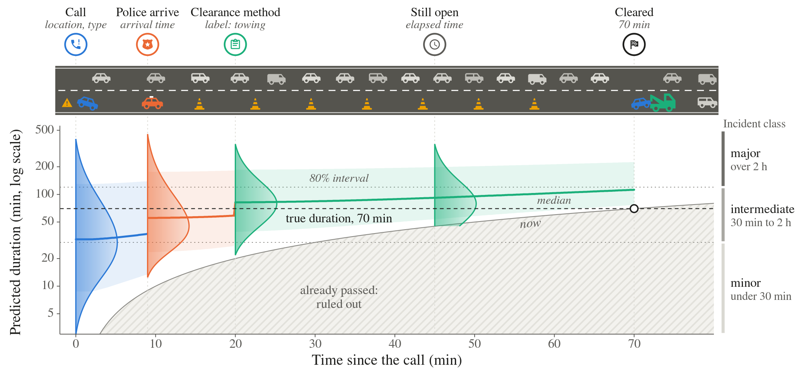

<h1 align="center">EvoDur</h1>

<p align="center"><b>One model for every stage of the response:<br>Bayesian updating of traffic incident duration forecasts</b></p>

<p align="center">
Xiaoyang Cao<sup>1</sup> &nbsp; Zhiyong Liu<sup>2</sup> &nbsp; Ruimin Li<sup>3</sup><br>
<sup>1</sup>Massachusetts Institute of Technology &nbsp; <sup>2</sup>Beijing Jiaotong University &nbsp; <sup>3</sup>Tsinghua University
</p>

<p align="center">
<b>Paper</b> (coming soon) &nbsp;|&nbsp;
<a href="#citation"><b>BibTeX</b></a>
</p>

<p align="center">


</p>

<p align="center"></p>

EvoDur (evolving duration forecasts) predicts how long a traffic incident will last and updates the forecast as the police arrive, the officer
reports how the incident is handled, and time passes. A neural network gives the forecast at the call; each later piece
of information enters through its own likelihood and is combined by Bayes' rule, so one model serves every stage of the
response and nothing is refitted.

This repository contains the model, the baselines and the scripts that regenerate every table and figure of the paper.

## Installation

```bash
git clone https://github.com/XiaoyangCao1113/EvoDur.git && cd EvoDur
pip install torch==2.14.1 --index-url https://download.pytorch.org/whl/cpu
pip install -r requirements.txt && pip install -e .
```

Python 3.10+, CPU only. A conda environment is in `environment.yml`.

## Data

```bash
scripts/download_data.sh          # NY/NJ/CT 511, Sydney, Seattle, San Francisco
python -m evodur.check_data       # compares row counts and checksums with the paper
```

The two Beijing datasets are available from the corresponding author on request.

## Quick start

Train EvoDur and a linear AFT model on one fold of the San Francisco data (about 2 min), then evaluate the Bayes
updates in every information state:

```bash
python -m evodur.run --data sanfrancisco --tau 1 --folds 5 --only-folds 0 --models AFT,Evidence-DeepMix-8 --batch 1024 --tag demo
python -m evodur.evidence --data sanfrancisco --tau 1 --folds 0 --batch 1024 --tag _demo_f0
```

Results are written to `results/`.

## Reproducing the paper

```bash
python scripts/make_jobs.py -o jobs.txt          # 790 independent jobs, one fold each
scripts/run_sequential.sh jobs.txt               # or: scripts/slurm_array.sbatch.example on a cluster
scripts/make_paper.sh results paper_out          # all tables and figures
```

The full run takes about 240 CPU job-hours. See [docs/REPRODUCE.md](docs/REPRODUCE.md) for the data snapshots, the
mapping from paper to code, compute times and the reproducibility check.

## Citation

```
@article{cao2026evodur,
  title   = {One model for every stage of the response: Bayesian updating of traffic incident duration forecasts},
  author  = {Cao, Xiaoyang and Liu, Zhiyong and Li, Ruimin},
  journal = {Preprint},
  year    = {2026}
}
```

## License

MIT, see `LICENSE`. Third-party material (Neural Fine-Gray, Material Design Icons) is listed in `THIRD_PARTY_NOTICES`.
The datasets are not part of this repository; follow the terms of use of each portal.
